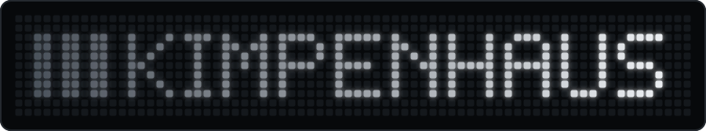

  

  decent&nbsp;dude &nbsp;//&nbsp; loving&nbsp;father&nbsp;of&nbsp;2 &nbsp;//&nbsp; straight&nbsp;edge &nbsp;//&nbsp; inked &nbsp;//&nbsp; horror&nbsp;movie&nbsp;geek &nbsp;//&nbsp; animal&nbsp;rights&nbsp;activist &nbsp;//&nbsp; traveler &nbsp;//&nbsp; runner

 

  <b>hi, I'm Marcus</b> – software engineer at <a href="https://devil-engineering.de">dev.IL engineering</a> in Bochum, Germany. 
  Kubernetes operators in .NET by day, a homelab full of blinking things by night.

 

 

 

  
  
  
  
  
  

